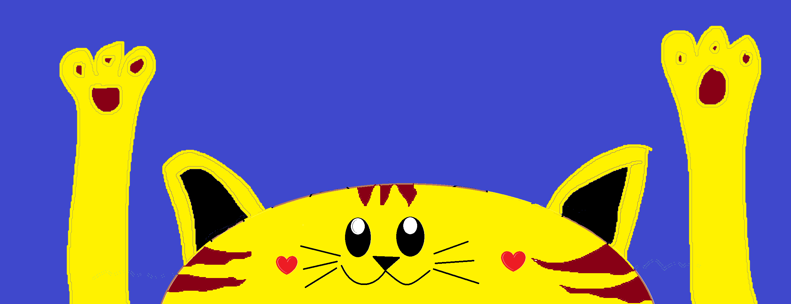

# 🐱 Gato Swing — Función de ritmo 1928 (versión Render)

Juego de ritmo multijugador estilo **caricatura de los años 20**. Una cabeza de gato gigante es la *rueda* del escenario: gira, baila, siente emociones y lanza obstáculos 3D que llegan **justo en el ritmo** de la canción. Los jugadores usan su **celular como control**.

Esta es la versión con **servidor propio en Render** (Express + Socket.IO), igual que Chicken Horde, Flappy Verbs y Castle Quest, pensada para la red restringida de la academia.



## Por qué Render (red de la academia)

- Pantalla y celulares hablan con el **mismo dominio** (`*.onrender.com`) por HTTPS/443. Nada de WebRTC, STUN/TURN, PeerJS ni CDNs.
- **Socket.IO empieza con HTTP long-polling** y sube a WebSocket solo si la red lo permite: funciona aunque el proxy bloquee WebSockets (probado).
- Todas las librerías (Three.js, Socket.IO, QR) y fuentes están en `public/vendor` y `public/fonts`.
- **Reconexión**: los celulares reintentan solos sin límite; vuelven con el mismo personaje y nombre (clave guardada en el celular).
- **Si la pantalla se recarga**, recupera la misma sala con su token; los celulares vuelven solos.
- **Si el servidor se reinicia** (deploy o el plan gratis se durmió), la pantalla pide su **mismo código** y los celulares que reintentan entran solos (probado: ~3 s).
- Latidos cada segundo, sincronización de relojes y **compensación de lag** en los saltos (también a través del servidor).
- iPhone: sin zoom por doble toque, alto real de pantalla, Wake Lock, reconexión al volver a la pestaña. Android viejo: el control es **ES5** y el cliente de Socket.IO también.
- `GET /healthz` para el health check de Render.

## Publicar en Render

1. Crea un repositorio en GitHub (por ejemplo `rischoker/GatoSwing`) y sube **todo el contenido** de esta carpeta (no el zip).
2. En Render: **New → Web Service** → conecta el repo.
   - Runtime: **Node** · Build: `npm install` · Start: `npm start`
   - Health check path: `/healthz`
3. Listo: `https://TU-SERVICIO.onrender.com/` es la **pantalla** (proyector) y los celulares entran con el QR (`/play.html?room=CODIGO`).

> Plan gratis de Render: el servicio se duerme tras ~15 min sin uso y tarda ~30–60 s en despertar. Abre la pantalla unos minutos antes de la clase (o usa un plan pago para evitarlo).

Para probar en tu PC: `npm install && npm start` y abre `http://localhost:3000`.

## Cómo se juega

1. Abre la página en un PC/TV (la "pantalla").
2. Cada jugador escanea el QR o entra a `play.html` y escribe el código de 4 letras.
3. A cada uno le toca un personaje al azar (aguacate, lata, maní, palmera…).
4. **¡SALTA!** cuando el obstáculo llegue a tus pies. Los saltos son "flotantes" (~1,1 s en el aire) y **tocar otra vez en el aire hace un DOBLE SALTO** con voltereta, ideal para pasar 2 o 3 obstáculos seguidos.
5. Saltar justo en el ritmo da **¡PERFECTO!** (x3) y combo.
6. **¡AL REVÉS!**: la rueda cambia de sentido. **¡MÁS RÁPIDO!**: cada ~25–38 s (al azar) la rueda acelera.
7. La rueda tiene dos carriles (adelante y atrás, separados por una línea punteada). En algunas secciones hay obstáculos de **medio carril**: solo saltan los del carril afectado.
8. **Barandas para patinar 🛹**: en las notas largas aparece una baranda sobre una fila de pinchos. Salta encima y **mantén presionado** para patinar con chispas hasta el final (salto automático con voltereta y bonus por tiempo). Si sueltas, te resbalas.
9. **El gato tiene emociones** según cómo juegan todos: alegría (perfectos), **disfrutando** con los ojos cerrados y notas musicales (racha del grupo), sorpresa (alguien cae, cambios), irritación (timing descuidado) y enojo (varios K.O. seguidos: cara roja, dientes, puños y vapor por las orejas).
10. Los personajes sueltan **globos de slang de b-boy** cuando van en racha o patinan: ¡COOL!, ¡SUPERFLY!, ¡FRESH!, ¡WINDMILL!, ¡HEADSPIN!…
11. El fondo cambia de color según la energía de la canción (azul/verde tranquilo, morado con ritmo, rojo/magenta intenso, naranja a tope).

| Acción | Celular | Teclado 1 | Teclado 2 |
|---|---|---|---|
| Saltar (2 veces = doble salto; mantener = patinar) | botón gigante | Espacio / W | ↑ |
| Maullar | 🐾 ¡MIAU! | M | N |

En la pantalla: **H** muestra los hitboxes, **Esc/P** pausa (intermedio).


## Ritmo y obstáculos

- Al cargar una canción se analiza en un *Web Worker*: flujo espectral → tempo por autocorrelación → seguimiento de beats por programación dinámica → fuerza/energía por beat y tiempo 1 del compás.
- La partitura lee las **notas** de la canción (onsets en semicorcheas), no solo el pulso, como un Guitar Hero: acentos fuertes → obstáculo suelto y grande; ráfagas de notas → grupos de 2–3 obstáculos seguidos, cada uno en su nota, que se pasan con un salto largo o doble salto. Por eso el intervalo entre obstáculos varía con la música (no es predecible).
- La densidad y los patrones suben con la energía de cada frase; hay secciones de medio carril, cambios de sentido en inicios de frase y aceleraciones cada ~25–38 s.
- Las **notas largas** (tramos con sonido sostenido y pocos ataques nuevos) se convierten en barandas; el generador verifica que siempre se pueda subir a la baranda y que la caída sea a tiempo para lo siguiente.
- La partitura se genera en un *Web Worker* durante la transición, sin congelar la pantalla.
- Los jugadores se ubican sobre la cabeza separados por **una fracción musical** (1, ½ o ¼ de beat) de recorrido del obstáculo: a cada uno le llega su obstáculo justo en un tiempo o subdivisión.
- Puedes cargar **cualquier MP3** desde el lobby; el botón ↺ vuelve a la canción original.
- *Ajustes → Retraso del audio*: compensa parlantes Bluetooth o TV con retraso.

### Hitboxes

Cada obstáculo es una unión de primitivas (caja, círculo, triángulo). **Las mismas primitivas construyen la malla 3D y la colisión**, así que lo que ves es lo que golpea. La colisión se calcula a 240 Hz. Antes de aceptar un grupo de obstáculos, el generador **prueba todos los despegues posibles y todos los momentos de doble salto** con la física real, y exige una ventana mínima de despegue (Fácil 160 ms, Normal 120 ms, Difícil 90 ms). Si no se puede pasar, encoge los obstáculos o quita uno del grupo; también garantiza que aterrices a tiempo para el siguiente grupo en tu carril. El hitbox del jugador es un poco más angosto que el dibujo (más justo para el jugador).

```bash
# test de partitura + hitboxes (necesita ffmpeg para convertir el audio)
ffmpeg -i public/assets/audio/ww.mp3 -ac 1 -ar 11025 -f f32le /tmp/ww.f32
npm test -- /tmp/ww.f32
```

Hay también un test de red de punta a punta (`tests/red.e2e.cjs` y `tests/reinicio.e2e.cjs`).

El test de partitura (3 dificultades × 3 semillas) verifica que todo grupo tenga ventana de despegue, que un jugador que sigue el plan (con doble salto cuando hace falta y patinando cada baranda) sobreviva **toda la canción en cualquier posición y carril**, que sin saltar se muera y que cada llegada caiga en el ritmo. También reporta la variedad: grupos de 1/2/3, medio carril, aceleraciones y cuánto varía el intervalo entre obstáculos.

## Personajes

Los modelos GLB no traen esqueleto: al cargarse se les quitan las piernas/brazos finitos y se les ponen **extremidades de manguera** con guantes blancos y zapatos, animadas por código (caminar, correr, saltar con *squash & stretch*, bailar al beat en el lobby y salir volando en K.O.).

**Agregar un personaje:** copia `nuevo.glb` en `public/assets/characters/`, agrégalo a `CHARACTERS` en `public/js/host/characters.js` y genera su retrato abriendo `/tools/retratos.html` en el servidor (guárdalo en `public/assets/portraits/nuevo.png`).


## Estructura

```
server.js              servidor Express + Socket.IO (salas, reconexión, /healthz)
package.json
public/index.html      pantalla (host): lobby, juego, resultados
public/play.html       control del celular
public/config.js       ajustes (latido)
public/js/host/net.js  red de la pantalla (Socket.IO)
public/js/play.js      control del celular (ES5, Socket.IO)
public/js/host/*.js    juego, física, partitura, gato, personajes, efectos
public/vendor/         three.js, socket.io, qrcode (locales)
tests/chart.test.mjs   test de ritmo + hitboxes
tests/red.e2e.cjs      prueba de red (BLOCK_WS=1 simula el proxy)
tests/reinicio.e2e.cjs prueba de reinicio del servidor
```

Ver [CREDITS.md](CREDITS.md) para licencias.
